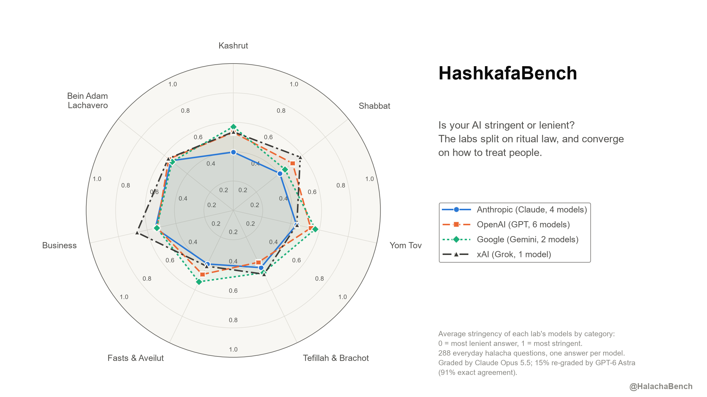
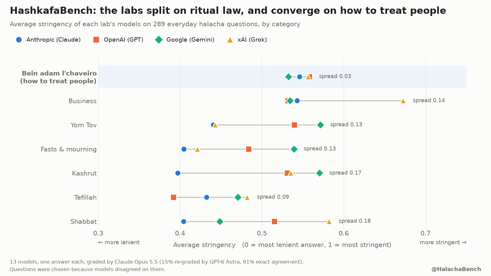
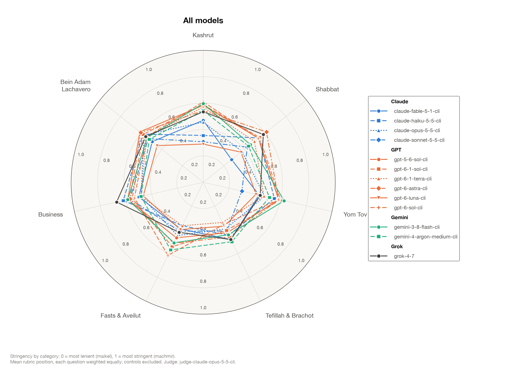
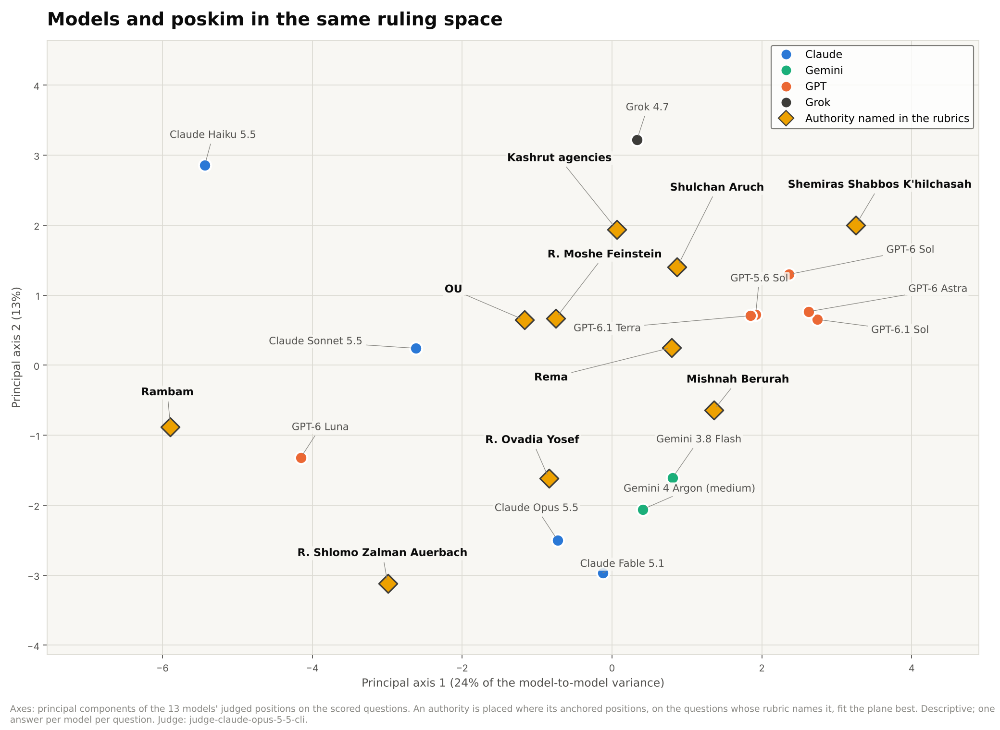
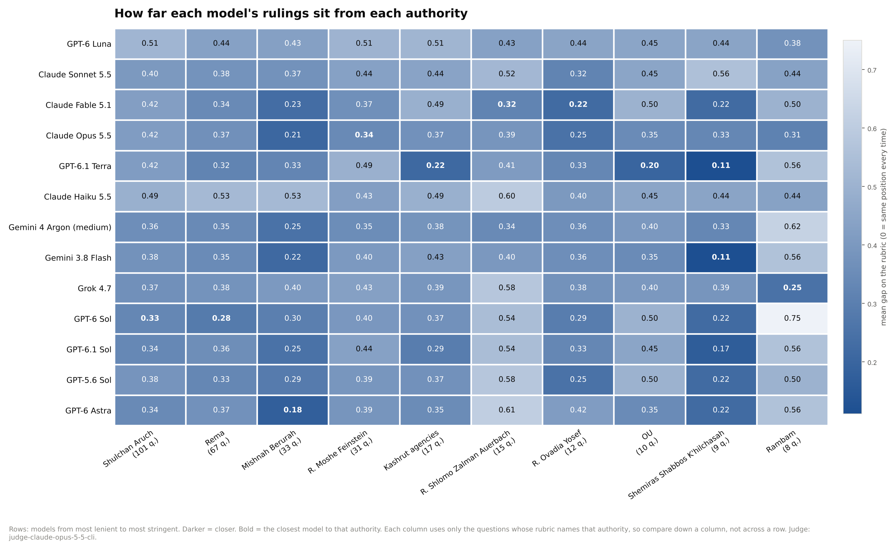
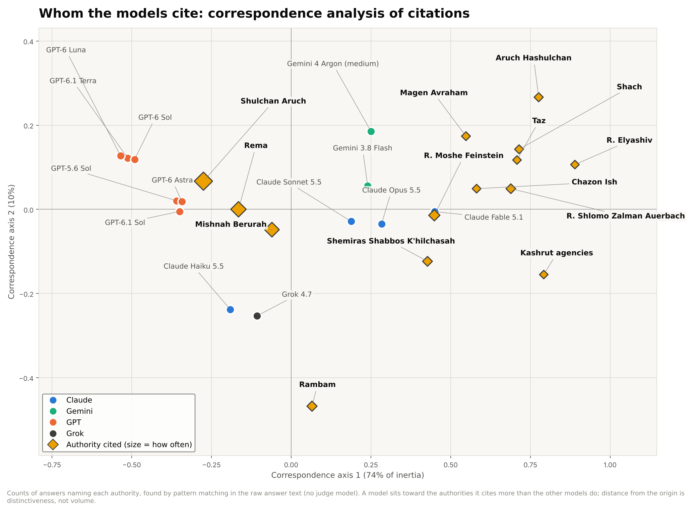
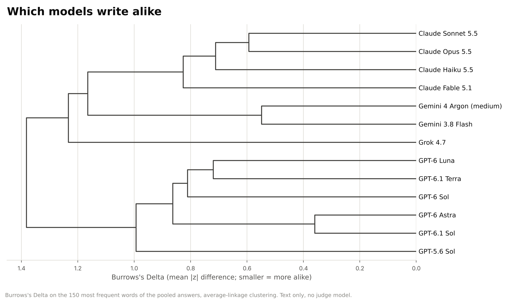

# HashkafaBench: is your AI stringent or lenient?

Religious Jews already ask AI models everyday halachic questions. HashkafaBench measures which way the models lean:
how stringent (machmir) or lenient (maikel) each model's rulings are, by area of halacha.

Results of 6 November 2026, from a sibling project of [HalachaBench](https://github.com/halachabench/halacha-bench-results).
They describe how models answer; they are not psak, and no answer here should be relied on in practice.

## Setup

- **Models:** 13, from four labs. Anthropic: Claude Fable 5.1, Opus 5.5, Sonnet 5.5, Haiku 5.5. OpenAI: GPT-6 Astra,
  GPT-6.1 Sol, GPT-6.1 Terra, GPT-6 Luna, GPT-5.6 Sol, GPT-6 Sol. Google: Gemini 3.8 Flash, Gemini 4 Argon (medium
  effort). xAI: Grok 4.7. Each ran through its maker's command-line tool with tools and web search off, one answer per
  question.
- **Questions:** 288 everyday questions in seven areas (Shabbat, Yom Tov, kashrut, tefillah, fasts and mourning,
  business, bein adam lachavero), asked in English as an Ashkenazi Jew, with no community or denomination stated. Most
  questions (about 250) were kept only because an earlier panel of six models disagreed on them, so the bank is built
  to find differences.
  Control questions with settled answers check knowledge and grading; they are left out of the stringency index.
- **Scoring:** each question has a written rubric of positions from 0 (most lenient) to 1 (most stringent). A judge
  model places each answer on that rubric. Primary judge: Claude Opus 5.5 on every answer; GPT-6 Astra re-graded a
  fixed 15% sample (91% exact agreement). A later check re-graded every answer with Claude Fable 5.1: all 21
  pre-selected comparisons came out the same, and Fable did not grade Claude's answers more leniently than anyone
  else's.
- **Comparisons:** 21 lab-against-lab comparisons were chosen before the answers were collected, paired by question,
  with 95% bootstrap intervals and Holm-corrected p-values within each family. Only those 21 are confirmatory;
  everything else below is descriptive.

The question bank and the individual answers are not published, to keep them out of model training data.

## Results

| Model | Stringency (0 lenient – 1 stringent) | 95% CI |
|---|---|---|
| GPT-6 Astra | 0.56 | 0.52 – 0.61 |
| GPT-6.1 Sol | 0.55 | 0.50 – 0.59 |
| GPT-5.6 Sol | 0.55 | 0.50 – 0.59 |
| GPT-6 Sol | 0.54 | 0.50 – 0.58 |
| Gemini 3.8 Flash | 0.53 | 0.49 – 0.57 |
| Grok 4.7 | 0.53 | 0.49 – 0.57 |
| Gemini 4 Argon (medium) | 0.51 | 0.46 – 0.55 |
| Claude Haiku 5.5 | 0.50 | 0.46 – 0.54 |
| GPT-6.1 Terra | 0.48 | 0.43 – 0.52 |
| Claude Opus 5.5 | 0.46 | 0.42 – 0.50 |
| Claude Fable 5.1 | 0.43 | 0.39 – 0.47 |
| Claude Sonnet 5.5 | 0.43 | 0.38 – 0.47 |
| GPT-6 Luna | 0.39 | 0.35 – 0.44 |

Adjusted stringency from a mixed model (model + question), Opus judge. Full tables in [data/](data).

**What the pre-selected comparisons show**

- **Claude is the most lenient lab.** Claude's models average about 0.07 below GPT, Gemini and Grok overall; all three
  gaps survive correction. The largest tested gap is Claude vs Grok on Shabbat (0.18).
- **GPT, Gemini and Grok are not distinguishable** from each other overall.
- **Bein adam lachavero: no lab difference.** All four labs average 0.53–0.57 on interpersonal questions.

**Descriptive findings**

- Where halacha and ordinary decency agree, the models agree. Asked whether to tell a friend the bride is beautiful
  when you don't think so, 12 of 13 said yes, as Beis Hillel rules; the exception was Claude Haiku 5.5. On using an
  embarrassing nickname, repeating a friend's news, or building a window that looks into a neighbor's yard, 11 of 13
  gave the strictest answer and none the most lenient.
- Where halacha gets specific, they split: who pays for a windshield cracked while driving a borrowed car (7 vs 6);
  whether maaser can go to the Red Cross (7 no, 4 yes, 2 in between).
- A model's overall lean explains only about 2% of the variation in positions; the question explains about 35% and
  the model-by-question interaction (with one-run noise) the rest. All 13 models gave the same answer on fewer than 2%
  of questions.
- Within one lab the spread can exceed the gap between labs: GPT-6 Luna is the most lenient model (0.39) and GPT-6
  Astra the most stringent (0.56).
- Almost every answer reads as hashkafically "unclear": the models do not signal a chareidi, dati leumi or modern
  orthodox orientation.

## Which poskim are the models closest to?

Three views, from most to least dependent on the judge model. All three are descriptive: no
comparison here was pre-registered, and each model has one answer per question.

**1. Rulings.** Every rubric position names the authorities who hold it, so an authority can be
placed in the same space as the models: on each question whose rubric names them, their position
is the one they are named at. A model's distance from an authority is the mean gap on the 0–1
rubric between the model's judged position and the authority's, over those questions. Ten
authorities are named on at least 8 scored questions.

The axes are the first two principal components of the 13 models' positions on the 288 scored
questions; each authority is projected onto that plane from the questions it is named on. The
Claude models and the two Geminis sit on the side of R. Ovadia Yosef and R. Shlomo Zalman
Auerbach; the GPT models cluster with the Shulchan Aruch, Rema and Shemiras Shabbos K'hilchasah.

| Authority (questions) | Closest model (mean gap) | Farthest model (mean gap) |
|---|---|---|
| Shulchan Aruch (101) | GPT-6 Sol 0.33 | GPT-6 Luna 0.51 |
| Rema (67) | GPT-6 Sol 0.28 | Claude Haiku 5.5 0.53 |
| Mishnah Berurah (33) | GPT-6 Astra 0.18 | Claude Haiku 5.5 0.53 |
| R. Moshe Feinstein (31) | Claude Opus 5.5 0.34 | GPT-6 Luna 0.51 |
| Kashrut agencies (17) | GPT-6.1 Terra 0.22 | GPT-6 Luna 0.51 |
| R. Shlomo Zalman Auerbach (15) | Claude Fable 5.1 0.32 | GPT-6 Astra 0.61 |
| R. Ovadia Yosef (12) | Claude Fable 5.1 0.22 | GPT-6 Luna 0.44 |
| OU (10) | GPT-6.1 Terra 0.20 | GPT-6 Sol 0.50 |
| Shemiras Shabbos K'hilchasah (9) | Gemini 3.8 Flash 0.11 | Claude Sonnet 5.5 0.56 |
| Rambam (8) | Grok 4.7 0.25 | GPT-6 Sol 0.75 |

Read down a column of the heatmap, not across a row: each authority is measured on its own
questions. The bootstrap intervals in `data/poskim_closeness.csv` are wide (about ±0.1 for the
Shulchan Aruch, ±0.2 for authorities named on a dozen questions), and the closest and
second-closest model are rarely distinguishable. An authority's placement also reflects where
the rubric writers named them: R. Shlomo Zalman Auerbach and R. Ovadia Yosef appear mostly at
lenient anchors (mean anchored position 0.32 and 0.36), the Rambam and the kashrut agencies mostly
at stringent ones (0.69 and 0.68). "Closest to R. Ovadia Yosef" therefore largely means "lenient
where he is lenient".

**2. Citations (no judge model).** A pattern per authority is matched against the raw text of
each answer, and the models are compared on the share of answers that name each one. Correspondence
analysis puts models and authorities on one map; a model sits toward the authorities it cites more
than the others do.

The first axis (74% of the inertia) is breadth. Every model cites the Shulchan Aruch, Rema and
Mishnah Berurah; the labs differ in whether they go further. Share of answers naming each
authority, averaged within lab:

| Authority | Claude | Gemini | GPT | Grok |
|---|---|---|---|---|
| Shulchan Aruch | 83% | 84% | 73% | 67% |
| Rema | 62% | 51% | 42% | 42% |
| Mishnah Berurah | 59% | 51% | 32% | 36% |
| R. Moshe Feinstein | 30% | 33% | 4% | 14% |
| Rambam | 19% | 7% | 5% | 18% |
| R. Shlomo Zalman Auerbach | 16% | 16% | 1% | 5% |
| Shemiras Shabbos K'hilchasah | 15% | 15% | 2% | 10% |
| Aruch Hashulchan | 9% | 11% | 1% | 1% |
| R. Ovadia Yosef | 2% | 0% | 0% | 0% |

Claude and Gemini name 20th-century poskim (R. Moshe Feinstein, R. Shlomo Zalman Auerbach,
Shemiras Shabbos K'hilchasah) in roughly one answer in six; the GPT models almost never do, and
stop at the Shulchan Aruch, Rema and Mishnah Berurah. Claude Fable 5.1 cites most widely (Shach
in 14% of answers, Aruch Hashulchan 23%, R. Elyashiv 9%). R. Ovadia Yosef is almost never cited by
any model, consistent with the Ashkenazi asker. Full counts: `data/citations_by_model.csv`.

**3. Style (no judge model).** Burrows's Delta, the standard authorship-attribution measure,
on the 150 most frequent words of each model's pooled answers.

The models cluster by lab: the GPT models in one branch (GPT-6 Astra and GPT-6.1 Sol are nearly
indistinguishable, Delta 0.36), the Claude models and the two Geminis in another, Grok nearest the
Claude branch. This compares models with models only. The poskim write in Hebrew and the models
in English, so no text-level comparison with the poskim themselves is made; the responsa corpora
would also be translation-mediated, which would measure the translator's style.

Code: `hashkafa/poskim.py` and `hashkafa/poskim_text.py` in the (private) harness repository.

## Files

- `data/per_model_summary.csv`: per-model stringency, rates of ruling, deferring to a rabbi, refusals, control accuracy.
- `data/stringency_by_category.csv`: stringency per model and category.
- `data/stats_preselected_contrasts.csv`: the 21 pre-selected comparisons with intervals and corrected p-values.
- `data/stats_mixed_model__*.csv`, `data/stats_variance_shares.csv`, `data/stats_power.csv`: model-based estimates,
  variance decomposition and power.
- `data/judge_agreement.csv`: Opus vs Astra agreement on the shared sample.
- `data/poskim_closeness.csv`, `data/poskim_nearest.csv`, `data/poskim_coverage.csv`, `data/poskim_map.csv`: each
  model's distance from each authority named in the rubrics (with bootstrap intervals), the nearest authority per
  model, how many questions name each authority, and the coordinates of the ruling-space map.
- `data/citations_by_model.csv`, `data/citation_shares_by_model.csv`, `data/citations_ca.csv`: which authorities
  each model names in its answers, and the correspondence-analysis coordinates.
- `data/style_delta.csv`: Burrows's Delta between every pair of models.
- `charts/`: the charts above and one radar per model.

## Limits

One answer per model per question, so run-to-run noise is mixed into the per-question results. Most questions were
selected for disagreement and are not a random sample of everyday questions. Rubric positions were written and
source-checked by the team and AI models, not yet reviewed by rabbis. The judges are themselves models from the labs
being compared.

Contact: halachabench@gmail.com
